# 🎙️ 工业级二次元语音质检漏斗与自蒸馏闭环架构规范 (Quality Funnel & Self-Distillation)

> 本文档规范了 jiuguan-voice-gateway 的 **4-Stage (+ Stage 3.5) 语音质检漏斗体系** 与 **GPT-SoVITS 自蒸馏数据飞轮**。
> 专门解决二次元强情绪语音合成中的“字对音错”、“复读机死循环”、“Siri机械棒读”、“声码器金属电音破音”、“模型多轮自迭代坍塌”等痛点。

---

## 🏗️ 整体质检与飞轮架构 (Architecture Overview)

```mermaid
flowchart TD
    RawAudio["原始音频 / 待测合成语音 (WAV/Bytes)"] --> S1["Stage 1: 声学物理与自愈门禁 (Acoustic Physics Gate)"]

    subgraph S1_Detail["Stage 1 核心特性"]
        S1A["pyloudnorm Integrated LUFS (-18.0) & True Peak (<= -1.0 dBTP)"]
        S1B["[whisper]/[sigh] 弱音标签增益豁免"]
        S1C["局部 VAD 停顿检测 (max_internal_silence <= 600ms)"]
        S1D["净发声语速 (Net CPS 2.0 ~ 10.0)"]
        S1E["20ms Cosine Fade 余弦淡入淡出 (消除硬切截断 Click)"]
    end
    S1 --> S1_Detail --> S2["Stage 2: 语义与对齐门禁 (ASR Alignment Gate)"]

    subgraph S2_Detail["Stage 2 核心特性"]
        S2A["cn2an 前置双向口语正则化 (展开百分比、数字、量词)"]
        S2B["G2P 音素级 PER 序列校验 (pypinyin / pyopenjtalk 拦截多音字)"]
        S2C["动态分段门限 (短文本 PER==0 / 长文本 CER<=5%)"]
        S2D["纯语气词豁免 (唔……/啊！)"]
        S2E["差集复读机检测 (放行合法叠词，拦截 6+ 循环) 与尾音死拖长"]
    end
    S2 --> S2_Detail --> S3["Stage 3: 角色音色一致性门禁 (Speaker Consistency Gate)"]

    subgraph S3_Detail["Stage 3 核心特性"]
        S3A["多情绪原型锚点池 (Multi-Prototype Anchors)"]
        S3B["Max-Pooling 余弦相似度最高匹配"]
        S3C["时长自适应门限 (时长 < 1.5s 平缓降至 0.70)"]
    end
    S3 --> S3_Detail --> S35["Stage 3.5: 韵律与情感表现力门禁 (Prosody Expressiveness Gate)"]

    subgraph S35_Detail["Stage 3.5 核心特性"]
        S35A["帧级 F0 自相关提取与 Pitch Std (>= 12.0 Hz)"]
        S35B["动态半音范围 (Semitone Range >= 3.5) 拦截 Siri 机械棒读"]
        S35C["Prompt 情绪标签对齐 (拦截傲娇/愤怒塌缩为 Flat Neutral)"]
    end
    S35 --> S35_Detail --> S4["Stage 4: 神经与心理声学 MOS (UTMOS & Vocoder Glitch Gate)"]

    subgraph S4_Detail["Stage 4 核心特性"]
        S4A["生成式 TTS 专用评估器 UTMOS (VoiceMOS 冠军架构)"]
        S4B["高频金属电音与梳状滤波识别 (detect_vocoder_artifacts)"]
        S4C["RMVPE / F0 连续性跳变检测 (detect_pitch_glitches 捕捉 >10 半音破音)"]
        S4D["BAK 门限放宽至 3.5 (兼容自然呼吸与口水音)"]
    end
    S4 --> S4_Detail --> PassAudio["✅ 极品合格音频 (Pass / Repaired Pass)"]

    subgraph Flywheel["🔄 自蒸馏闭环飞轮 (Self-Distillation Flywheel)"]
        PassAudio --> RejectionSampling["Best-of-N 拒绝采样 (择优录用)"]
        RejectionSampling --> Annealing["5:5 动态退火配比 (50% 黄金原声 + 50% 极品合成)"]
        Annealing --> TrainDataset["GPT-SoVITS 微调训练集 (.list)"]
    end
```



---

## 🔬 逐级门禁详细指标与判定规则

### 1. Stage 1: 声学物理与分位数自愈门禁 (`core/acoustic_gate.py`)
- **响度标准化 (LUFS)**：
  - 弃用生硬的 RMS 绝对值对齐，改用 ITU-R BS.1770-4 标准的 `pyloudnorm` 计算 Integrated LUFS（默认目标 `-18.0 LUFS`）。
  - **4x 过采样 True Peak 计算**：检测样本真实模拟峰值，严格限制 $\text{Peak} \le -1.0\text{ dBTP}$，彻底防止高频削顶失真（Clipping）。
- **弱音标签豁免与防爆音**：
  - 自动识别台词中的 `[whisper]`, `[sigh]`, `(耳语)`, `(叹气)` 弱音标签；
  - 豁免对弱音样本的主动能量拉升，仅施加峰值防爆音限制，避免将底噪放大为轰鸣声；AcousticGate 对应放宽静音门限至 `-60.0 dBFS`。
- **局部 VAD 与停顿检测**：
  - 计算 `max_internal_silence_sec`（句中非标点停顿不得超过 `600ms`），精准识别句中卡壳与空洞。
  - **净语速 (Net CPS)**：剔除静音段后仅统计有效发音区间的发音速率，将合理语速收紧至 `2.0 ~ 10.0 CPS`。
- **余弦平滑 Cosine Fade**：
  - 静音切除前沿与后沿保留 `120ms` 舒适呼吸区，并施加 `20ms` 的余弦淡入淡出（Cosine Fade），彻底消除截断清辅音起音引发的高频数字 Click 杂音。

---

### 2. Stage 2: 语义对齐与音素级校验门禁 (`core/asr_verifier.py`)
- **前置双向口语正则化 (Text Normalization)**：
  - 集成 `cn2an` 将参考文本与 ASR 识别结果中的阿拉伯数字、度量衡、百分比（如 `35%` -> `百分之三十五`）统一展开为中文标准口语音素。
  - 采用 **Dual-Alignment 双向最优比对**：$\text{CER} = \min(\text{CER}_{\text{raw}}, \text{CER}_{\text{norm}})$，兼顾口语表达与纯数字序列。
- **G2P 音素级/拼音序列 PER 对齐**：
  - 中文集成 `pypinyin` 转换为带声调拼音序列；日文集成 `pyopenjtalk` 转换为国际音标音素序列。
  - 计算音素序列编辑距离（Phoneme Error Rate），精准拦截“字对音错”的多音字混淆（例如“行(háng/xíng)长”、“重(zhòng/chóng)要”）。
- **分段动态阈值与叹词豁免**：
  - **短文本（$\le 6$ 字）**：执行严格的 `PER == 0`（零容忍错音），但自动豁免纯语气词（“唔……”、“啊！”、“嗯哼”）。
  - **长文本（$> 15$ 字）**：允许 CER $\le 5\%$，包容个别近音同音字。
- **差集复读机与尾音死拖长检测**：
  - 比较参考文本自身的 N-gram 出现频次：仅当 $\text{Count}(\text{ASR}) > \text{Count}(\text{Ref}) + 1$ 时才判定为死循环，完美放行二次元合法台词（“笨蛋笨蛋笨蛋！”、“欧拉欧拉欧拉”），拦截 6+ 次无序死循环。
  - 分析末尾 `500ms` 帧级能量平稳度，拦截模型常见的元音末尾死拖长（Drone artifact）。

---

### 3. Stage 3: 角色多情绪原型矩阵与时长自适应 (`core/speaker_verifier.py`)
- **多情绪原型锚点池 (Multi-Prototype Anchors)**：
  - 废弃全局单一平均声纹。按角色声线特征维护子锚点字典：`{"Anchor_Normal": e1, "Anchor_Angry": e2, "Anchor_Whisper": e3, "Anchor_Tsundere": e4}`。
- **Max-Pooling 相似度匹配**：
  - 计算待测样本与所有子锚点的余弦相似度，取最大值并记录命中原型：
    $$\text{Score}_{\text{spk}} = \max_{k \in \text{Clusters}} \cos(\mathbf{e}_{\text{gen}}, \mathbf{e}_{\text{anchor}}^{(k)})$$
- **时长自适应门限 (Duration-Adaptive Threshold)**：
  - 当音频时长 $< 1.5\text{s}$ 时，余弦阈值动态平缓从 `0.78` 下调至最低 `0.70`，避免因超短音频信息熵不足误杀角色特色短语气词。

---

### 4. Stage 3.5: 韵律与情感表现力门禁 (`core/prosody_gate.py`)
- **基频标准差 (Pitch Std) 与半音范围 (Semitone Range)**：
  - 基于自相关帧级分析提取 F0 曲线；
  - 设定 `min_pitch_std = 12.0 Hz` 与 `min_semitone_range = 3.5` 半音，强力拦截指标合格但语调毫无起伏的“冷漠死鱼读 / Siri 机器人朗读腔”。
- **Prompt 情感表现力对齐**：
  - 提取台词中 `[tsundere]`, `[angry]`, `(傲娇)` 等情绪指令；
  - 若 Prompt 要求高唤醒度情感但音频在声学特征空间上退化为平直 Neutral，即刻触发情感错位拦截。

---

### 5. Stage 4: 生成式 TTS 专用评估器与破音检测 (`core/speech_mos.py`)
- **专用评估器 `UTMOSVerifier`**：
  - 基于 VoiceMOS Challenge 冠军架构理念，专为神经网络 TTS 训练；
  - 保留背景纯净度 BAK，并将门限适度放宽至 `3.5`（包容声优自然换气与轻微口水音）。
- **神经声码器金属电音伪影识别 (`detect_vocoder_artifacts`)**：
  - 监测 $>7.5\text{kHz}$ 超高频能量占比与高频峰均比，筛除 HiFi-GAN / BigVGAN 常出现的金属泛音、相位梳状滤波与蜂鸣电音。
- **F0 连续性与破音跳变捕捉 (`detect_pitch_glitches`)**：
  - 检测相邻有声帧间导数瞬态阶跃（跳变 $>10$ 半音且 $>100\text{Hz}$），拦截跨音区破音、电音尖叫与声码器崩溃。

---

## 🔄 自蒸馏闭环飞轮升级 (`scripts/build_distillation_dataset.py`)

1. **5:5 动态退火配比 (Dynamic Annealing)**：
   - 彻底废除 70% 合成 + 30% 原声的激进配比；
   - 采用 **50% 黄金原声 + 50% 极品合成数据**（`--human-ratio 0.50`），有效保障模型方差不收缩，杜绝多轮自蒸馏迭代后的音色衰减与模型退化（Model Collapse）。
2. **领域词特征加权 (`calculate_domain_richness`)**：
   - 对包含生僻字、多音字、度量衡、科技术语（如“RTX 5070”、“35%”）的长难句样本赋予丰富度加成，优先吸纳扩充角色词汇库的合成样本。
3. **Best-of-N 拒绝采样 (Rejection Sampling)**：
   - 对同一文本进行 $N$ 次推理候选时，计算综合品质得分：
     $$\text{Score} = \text{UTMOS} + \text{Similarity} - \text{PER} + \text{Domain\_Bonus}$$
   - 调用 `select_best_of_n()`，在同题样本中仅录取排名第 1 的帕累托最优样本入库。

---

## 🛠️ CLI 常用指令与自动化流水线

```bash
# 1. 运行系统级全量验收测试 (113 项核心测试)
make audit

# 2. 批量清洗原始音频数据集 (执行 4-Stage 漏斗筛选)
python3 scripts/filter_dataset.py \
  --input-dir assets/user_recordings \
  --transcripts assets/user_recordings/transcripts.list \
  --output-dir assets/cleaned_dataset \
  --output-list assets/cleaned_dataset/train.list

# 3. 构建 5:5 均衡配比的自蒸馏训练数据集 (Best-of-N 拒绝采样)
python3 scripts/build_distillation_dataset.py \
  --golden-list assets/audio/training_dataset/golden.list \
  --synthetic-list assets/tts_eval_samples/train.list \
  --output-list assets/distillation_train.list \
  --human-ratio 0.50 \
  --enable-best-of-n

# 4. 执行多维 TTS 基准压测与生成可视化 HTML 报告看板
python3 scripts/benchmark_tts_pipeline.py \
  --url http://192.168.10.4:8000/api/tts/generate \
  --report-html logs/tts_benchmark_report.html \
  --report-json logs/tts_benchmark_report.json
```
