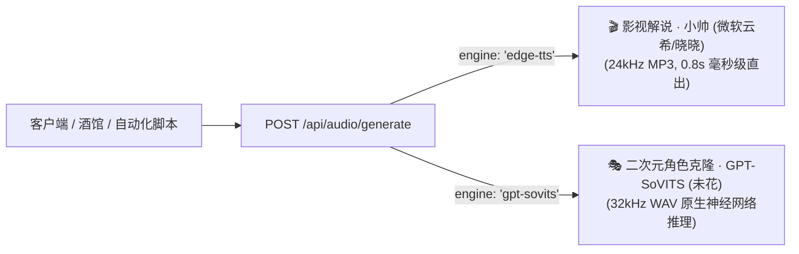

# 🎙️ 解耦多引擎语音合成服务 (Multi-Engine TTS) API 规范文档

本文档提供系统当前已解耦的 **多引擎语音合成后端服务（端口 `8888`）** 的全部 RESTful API 接口说明与多语言调用示例。

- **服务端口**: `8888`
- **局域网基础路径 (Base URL)**: `http://127.0.0.1:8888`
- **本地基础路径 (Local URL)**: `http://127.0.0.1:8888`

---

## 📌 一、支持的引擎架构概览



| 引擎标识 (`engine`) | 核心音色 / 角色 | 输出格式 | 典型场景 | 推荐语速 (`speed`) |
| :--- | :--- | :---: | :--- | :---: |
| **`edge-tts`** | **小帅 (云希)** (`zh-CN-YunxiNeural`)<br/>**晓晓** (`zh-CN-XiaoxiaoNeural`)<br/>**云健** (`zh-CN-YunjianNeural`)<br/>**晓伊** (`zh-CN-XiaoyiNeural`) | `audio/mpeg` (MP3) | 影视解说速通、知识科普、有声书、商业客服 | `1.15` (解说)<br/>`1.00` (播音) |
| **`gpt-sovits`** | **圣园未花** (`mika`) | `audio/wav` (WAV) | 二次元角色卡、AI伴侣、动漫原声剧情互动 | `1.00` |

---

## 🌐 二、接口详细说明

### 1. 获取支持的引擎与音色清单

- **Method**: `GET`
- **Path**: `/api/audio/engines`

#### 响应示例 (`200 OK`)

```json
[
  {
    "id": "edge-tts",
    "name": "🎬 影视解说 · 小帅 (微软云希)",
    "type": "commercial_narration",
    "description": "全网经典影视解说、短视频速通、科普旁白标配音色，零延迟流式直出",
    "voices": [
      {"id": "zh-CN-YunxiNeural", "name": "小帅解说 · 影视速通 (云希)", "default_speed": 1.15, "default_pitch": "+0Hz"},
      {"id": "zh-CN-XiaoxiaoNeural", "name": "温柔知性 · 有声书/客服 (晓晓)", "default_speed": 1.0, "default_pitch": "+0Hz"},
      {"id": "zh-CN-YunjianNeural", "name": "沉稳厚重 · 纪录片/旁白 (云健)", "default_speed": 1.0, "default_pitch": "-2Hz"},
      {"id": "zh-CN-XiaoyiNeural", "name": "活泼轻快 · 年轻日常 (晓伊)", "default_speed": 1.1, "default_pitch": "+0Hz"}
    ]
  },
  {
    "id": "gpt-sovits",
    "name": "🎭 二次元角色克隆 · GPT-SoVITS",
    "type": "anime_character_clone",
    "description": "本地神经网络推理，1:1 复刻二次元声优独特声线与傲娇/撒娇微表情",
    "voices": [
      {"id": "mika", "name": "蔚蓝档案 · 圣园未花 (Mika)", "lang": "ja", "default_speed": 1.0}
    ]
  }
]
```

---

### 2. 语音合成核心接口

- **Method**: `POST`
- **Path**: `/api/audio/generate`
- **Content-Type**: `application/json`
- **返回类型**:
  - `edge-tts`: `audio/mpeg` (MP3 音频二进制流)
  - `gpt-sovits`: `audio/wav` (WAV 音频二进制流)

#### 请求参数 (Request Body)

| 参数名 | 类型 | 必填 | 默认值 | 详细说明 |
| :--- | :--- | :---: | :--- | :--- |
| `input` / `text` | `string` | **是** | - | 待合成的台词或解说文本 |
| `engine` | `string` | 否 | `edge-tts` | 引擎标识：`"edge-tts"` 或 `"gpt-sovits"` |
| `voice` | `string` | 否 | `zh-CN-YunxiNeural` | 音色标识（适用于 Edge-TTS） |
| `voice_mode` | `string` | 否 | `mika` | 角色标识（适用于 GPT-SoVITS） |
| `speed` | `float` | 否 | `1.0` | 语速乘数（范围 `0.8` ~ `2.0`） |
| `pitch` | `string` | 否 | `+0Hz` | 音调调节（如 `+2Hz`, `-2Hz`, `+5Hz`） |
| `language` | `string` | 否 | `auto` | 目标语言：`"japanese"` 或 `"chinese"` |

---

## 💻 三、调用示例代码

### 1. cURL 命令行调用

#### A. 合成小帅影视解说语音 (Edge-TTS)
```bash
curl -X POST http://127.0.0.1:8888/api/audio/generate \
  -H "Content-Type: application/json" \
  -d '{
    "engine": "edge-tts",
    "voice": "zh-CN-YunxiNeural",
    "speed": 1.15,
    "pitch": "+0Hz",
    "input": "注意看，眼前这个男人叫小帅，他怎么也没想到，自己竟然穿越到了异世界！"
  }' \
  --output xiaoshuai.mp3
```

#### B. 合成未花二次元原声语音 (GPT-SoVITS)
```bash
curl -X POST http://127.0.0.1:8888/api/audio/generate \
  -H "Content-Type: application/json" \
  -d '{
    "engine": "gpt-sovits",
    "voice_mode": "mika",
    "language": "japanese",
    "speed": 1.0,
    "input": "先生、おかえり！待ってたよ！ちゃーんといい子でお留守番してたんだから！"
  }' \
  --output mika.wav
```

---

### 2. Python 调用代码

```python
import requests

SERVER_URL = "http://127.0.0.1:8888/api/audio/generate"

# 1. 生成影视解说 (小帅)
def generate_xiaoshuai_audio(text: str, output_path: str = "xiaoshuai.mp3"):
    payload = {
        "engine": "edge-tts",
        "voice": "zh-CN-YunxiNeural",
        "speed": 1.15,
        "pitch": "+0Hz",
        "input": text
    }
    resp = requests.post(SERVER_URL, json=payload, timeout=30)
    if resp.status_code == 200:
        with open(output_path, "wb") as f:
            f.write(resp.content)
        print(f"✅ 小帅解说生成成功: {output_path}")
    else:
        print(f"❌ 生成失败: {resp.text}")

# 2. 生成二次元角色语音 (圣园未花)
def generate_mika_audio(text: str, output_path: str = "mika.wav"):
    payload = {
        "engine": "gpt-sovits",
        "voice_mode": "mika",
        "language": "japanese",
        "speed": 1.0,
        "input": text
    }
    resp = requests.post(SERVER_URL, json=payload, timeout=45)
    if resp.status_code == 200:
        with open(output_path, "wb") as f:
            f.write(resp.content)
        print(f"✅ 未花语音生成成功: {output_path}")
    else:
        print(f"❌ 生成失败: {resp.text}")

if __name__ == "__main__":
    generate_xiaoshuai_audio("注意看，真正的反击，才刚刚开始！")
    generate_mika_audio("先生、私のこと、待っててくれた？わはは～☆")
```

---

### 3. JavaScript / TypeScript 前端调用

```typescript
export async function synthesizeAudio(options: {
  engine: "edge-tts" | "gpt-sovits";
  text: string;
  voice?: string;
  speed?: number;
}): Promise<Blob> {
  const response = await fetch("http://127.0.0.1:8888/api/audio/generate", {
    method: "POST",
    headers: { "Content-Type": "application/json" },
    body: JSON.stringify({
      engine: options.engine,
      input: options.text,
      voice: options.voice || "zh-CN-YunxiNeural",
      speed: options.speed || 1.0,
    }),
  });

  if (!response.ok) {
    throw new Error(`TTS 请求失败: HTTP ${response.status}`);
  }

  return await response.blob();
}
```

---

## 🍻 四、酒馆（SillyTavern）接入配置

1. **TTS 插件类型**: 选择 `Custom (HTTP Endpoint)` 或 `OpenAI Compatible`
2. **API URL**: `http://127.0.0.1:8888/api/audio/generate`
3. **针对解说/通用助手角色**: Request Body 填 `{"engine": "edge-tts", "voice": "zh-CN-YunxiNeural", "input": "{{text}}"}`
4. **针对圣园未花二次元角色**: Request Body 填 `{"engine": "gpt-sovits", "voice_mode": "mika", "input": "{{text}}"}`
